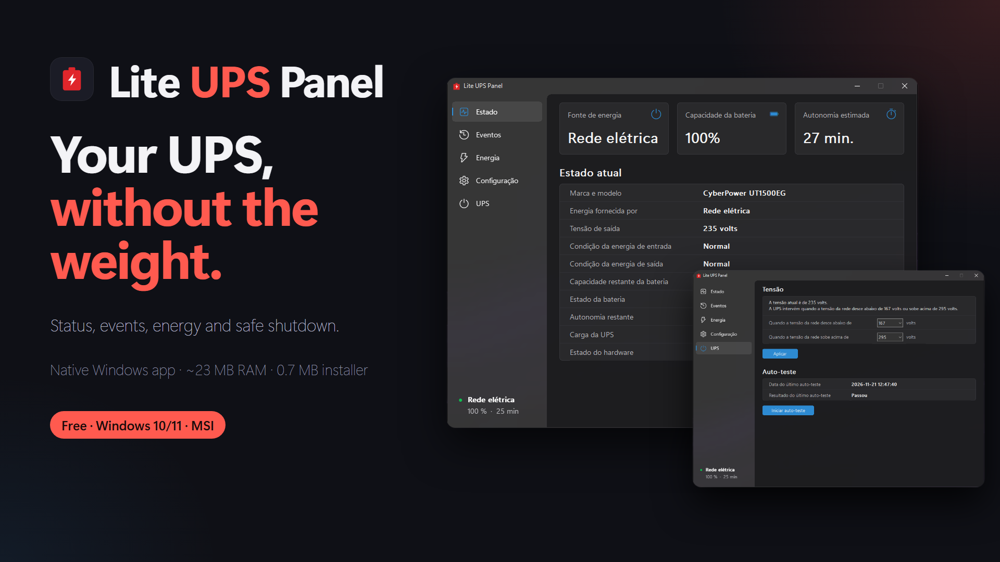
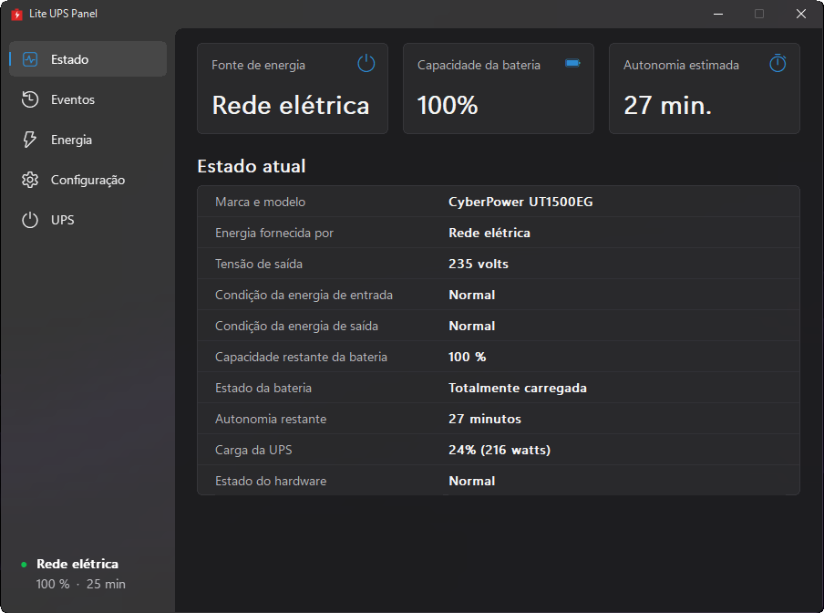
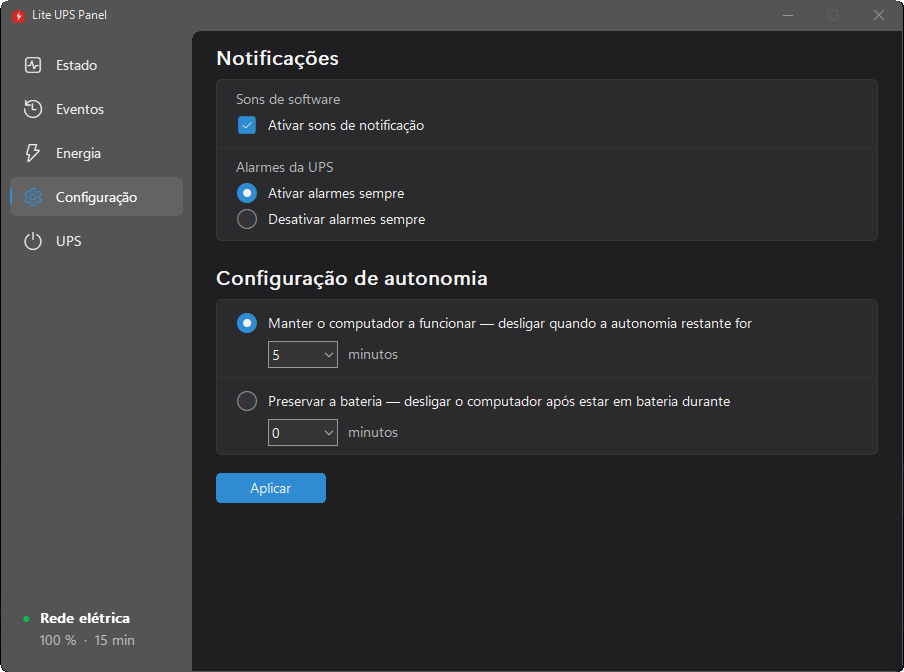
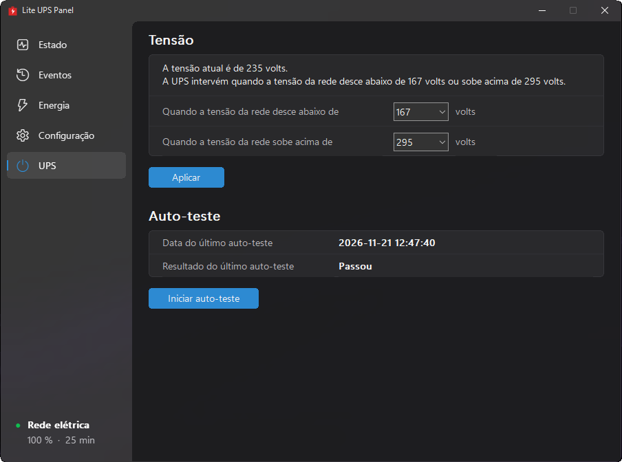

<div align="center">



**Monitor your USB UPS from a tiny native Windows app.**<br>
Status, power events, energy report and a safe, cancellable shutdown, in ~23 MB of RAM.

<a href="https://github.com/bacoinz/Lite-UPS-Panel/releases/latest"></a> <a href="LICENSE.md"></a>     <a href="https://ko-fi.com/bacoinz"></a>

[Download](https://github.com/bacoinz/Lite-UPS-Panel/releases/latest) · [Why Lite](#why-lite-ups-panel) · [Compared with PowerPanel](#compared-with-powerpanel-personal) · [Build it](#build-it) · [Changelog](CHANGELOG.md) · [🇵🇹 Português](README.pt-PT.md)


</div>

> [!NOTE]
> **The interface is in European Portuguese only.** The strings live in `src/ui_pages.rs`, `src/app.rs` and `src/nav.rs`, so translating them is a small, mechanical change.

## Why Lite UPS Panel

The software that ships with a UPS tends to be far bigger than the job it does: a bundled runtime, a couple of background services, thousands of files, and a few hundred MB of RAM to tell you the battery is at 100 %.

Lite UPS Panel does the same job as one small program:
- It is **one 1.4 MB executable** installed by a **0.7 MB MSI**.
- It sits in the tray, starts with Windows and stays out of the way.
- It talks to the UPS directly over USB HID, with no driver, service or runtime to install.

It started as a lean rewrite of the screens I actually used in CyberPower's PowerPanel Personal, and it now detects any UPS that follows the standard USB Power Device class.

## Features

**Status**

- **At a glance:** power source, battery capacity and estimated runtime, in three cards.
- **Details:** brand and model, output voltage, input and output power condition, battery state, remaining runtime, load (% and watts) and hardware state.
- **Tray icon** with a live tooltip, and a balloon notification when something happens. The sidebar always shows the current source and charge.

**Events**

- Every power failure, under- and over-voltage, Boost/Buck regulation, low battery, lost communication, self-test and shutdown is **logged** in a local SQLite database.
- A summary of power problems for the last week, month or year, and a searchable, filterable event log with paging.
- You can delete the events of a period.

**Energy**

- Daily average and accumulated consumption (kWh), accumulated **cost** and **CO₂ emitted**.
- Pick your country to fill the price per kWh and CO₂ per kWh, or type your own. kg or lb.

**Safe shutdown**

- Two policies:
  - **Keep the computer running**: shut down when the remaining runtime drops to N minutes.
  - **Preserve the battery**: shut down after N minutes on battery.
- A **30-second countdown** you can cancel. If the power comes back, it cancels itself.
- Flickers of a couple of seconds are ignored, and a self-test never triggers a shutdown. This logic is a pure state machine with unit tests.

**UPS settings** (when the UPS supports them)

- Set the **low and high transfer voltages**.
- Turn the **audible alarm** on or off.
- Start a **self-test** and see the date and result of the last one.
- Anything your UPS does not support is greyed out instead of failing.

**App**

- **Native Windows 11 look:** dark theme, Mica/Acrylic backdrop (on Windows 11; Windows 10 gets a plain dark background), rounded cards, Segoe UI and Segoe Fluent Icons, per-monitor DPI.
- **Responsive:** the UPS is polled on a background thread, so the window never freezes while HID is slow.
- **Any USB UPS:** it scans the HID report descriptor for the standard Power Device and Battery System usages instead of matching a vendor ID. Brand and model come from the USB strings, with a vendor-name fallback.
- **Starts with Windows**, in the tray. Launching it again opens the window.

## Screenshots

<table>
  <tr>
    <td width="50%"></td>
    <td width="50%"></td>
  </tr>
  <tr>
    <td></td>
    <td></td>
  </tr>
</table>

<sub>On a CyberPower UT1500EG.</sub>

## Compared with PowerPanel Personal

CyberPower's PowerPanel Personal is the app this one replaces on my PC. This is what I found when I took it apart, next to what Lite UPS Panel uses:

| | PowerPanel Personal | Lite UPS Panel |
|---|---|---|
| Built with | Frozen Python 3.10 (cx_Freeze + Cython), PyQt5, a bundled JRE | Rust, plain Win32 calls |
| Files installed | ~3,000 | 1 executable |
| Size | Not measured, but thousands of files | 0.7 MB MSI, 1.4 MB installed |
| Windows services | 2 (service + service monitor) | None |
| RAM while running | ~35 to ~300 MB, depending on the process and the window | **~23 MB working set, ~4 MB private** (idle, tray) |
| Brands | CyberPower | Any USB HID Power Device UPS (tested on CyberPower only) |
| Interface | Qt | Native Win32 with Mica/Acrylic |
| Cost | Free | Free for non-commercial use |

<sub>RAM figures: Lite UPS Panel was measured on the installed build (Task Manager "working set" and "private bytes"). The PowerPanel numbers are the range I saw across its processes, not a benchmark, so treat them as an order of magnitude.</sub>

**Day to day, they are used the same way:** open it to read the status, check the event log, look at the energy report, change the shutdown policy and run a self-test. Lite UPS Panel keeps those screens and drops the rest.

**What you give up.** Be aware of the trade-offs before you replace it:
- PowerPanel runs as **Windows services**, so it can watch the UPS before anyone logs in. Lite UPS Panel starts **at user login**, so it only protects a session that is logged in.
- It only covers the screens listed above. It is not a drop-in clone of every PowerPanel feature.
- It has only been tested on a **CyberPower UT1500EG**. Other brands should be detected, but I could not verify them. See the note below.

> [!IMPORTANT]
> If you try it on another UPS, check that the values on the **Status** page look right (voltage, capacity, runtime) before you rely on its automatic shutdown, and use the **Self-test** and a dry run (`UPSPANEL_DRYRUN=1`, which logs instead of shutting down) first. Issues with the model and the output of `ups-panel.exe --dump` are very welcome.

## Install

1. Download the MSI from the [latest release](https://github.com/bacoinz/Lite-UPS-Panel/releases/latest) and run it. It needs administrator rights, because it installs to `Program Files` and adds the start-up entry.
2. It starts with Windows from then on. Open it from the Start menu or by launching it again.
3. Uninstall it from *Settings → Apps*. Your events and settings stay in `C:\ProgramData\UPS Panel\ups.db`.

Do not run it next to PowerPanel Personal: two programs talking to the same UPS can get in each other's way. Uninstall PowerPanel first, or at least stop its services.

## Build it

You need Windows, a recent stable [Rust](https://rustup.rs) and, for the installer, the [WiX Toolset](https://wixtoolset.org) v4+ (`dotnet tool install --global wix`).

```powershell
git clone https://github.com/bacoinz/Lite-UPS-Panel
cd Lite-UPS-Panel
cargo test
cargo build --release
wix build wix/main.wxs -o ups-panel.msi
```

The release profile is tuned for size (`opt-level = "z"`, LTO, `panic = "abort"`, stripped).

Command-line switches of `ups-panel.exe`:

| Switch | What it does |
|---|---|
| `--status` | Prints the detected UPS, the values read and the report map, then exits |
| `--dump` | Dumps every HID interface and its report descriptor (useful for bug reports) |
| `--hidden` | Starts in the tray (this is what the start-up entry uses) |

## How it works

| Part | What it uses |
|---|---|
| UI | Win32 (`windows` crate), owner-drawn controls, DWM Mica/Acrylic |
| UPS access | `hid.dll` + SetupAPI: reads the HID report descriptor and maps the Power Device usages |
| Monitor and shutdown | A pure state machine (`monitor.rs`), `InitiateSystemShutdownEx` |
| Data | SQLite (`rusqlite`, bundled), in `C:\ProgramData\UPS Panel\ups.db` |
| Installer | WiX v4 MSI, per-machine, with a `Run` key for start-up |

```
src/hid.rs        HID discovery, report descriptors, vendor names
src/ups.rs        Descriptor scan -> report map, status, limits, alarm, self-test
src/monitor.rs    Event detection and shutdown decisions (unit tested)
src/db.rs         SQLite: events, hourly energy, tests, settings
src/theme.rs      Dark/Mica/Acrylic theme and owner-drawn controls
src/ui*.rs, nav.rs, app.rs   Window, pages, sidebar, tray
wix/main.wxs      MSI definition
```

## Support

If it saves you a few hundred MB of RAM, you can [buy me a coffee on Ko-fi](https://ko-fi.com/bacoinz). The GitHub **Sponsor** button on this repo goes there too.

## Not affiliated

This is an independent project. CyberPower and PowerPanel are trademarks of their owners; they are named here only to describe what Lite UPS Panel replaces and how it differs.

## License

[PolyForm Noncommercial 1.0.0](LICENSE.md). Free of charge, you can use it, change it and run it:
- for yourself, at home or in your own lab;
- for a school or a non-profit.

Selling it, or selling access to it as a service, is not allowed. For anything commercial, ask the author.
