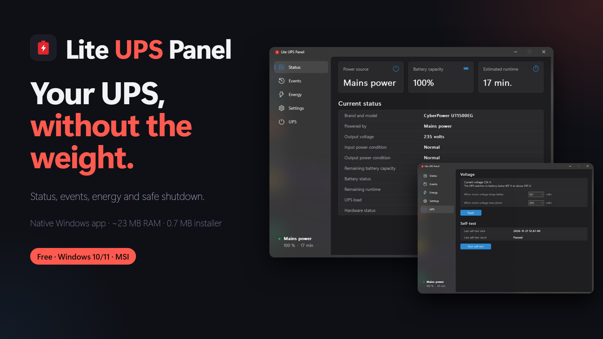

<div align="center">



**Monitoriza a tua UPS USB com uma app nativa de Windows minúscula.**<br>
Estado, eventos de energia, relatório de consumo e um desligar seguro e cancelável, com ~23 MB de RAM.

[Descarregar](https://github.com/bacoinz/Lite-UPS-Panel/releases/latest) · [English](README.md) · [Changelog](CHANGELOG.md) · [Ko-fi](https://ko-fi.com/bacoinz)

</div>

## Porquê

O software que vem com uma UPS costuma ser muito maior do que o trabalho que faz: um runtime incluído, dois serviços em segundo plano, milhares de ficheiros e algumas centenas de MB de RAM só para dizer que a bateria está a 100 %.

O Lite UPS Panel faz o mesmo trabalho num só programa pequeno: **um executável de 1,4 MB** instalado por um **MSI de 0,7 MB**. Fica na bandeja, arranca com o Windows e não incomoda. Fala com a UPS diretamente por USB HID, sem drivers, serviços nem runtimes.

Começou como uma versão leve dos ecrãs que eu usava no PowerPanel Personal da CyberPower e agora deteta qualquer UPS que siga a classe padrão USB Power Device.

## O que faz

- **Estado:** fonte de energia, capacidade da bateria, autonomia, marca e modelo, tensões, carga (% e watts) e estado do hardware. Ícone na bandeja com notificações.
- **Eventos:** falhas de energia, subtensão, sobretensão, Boost/Buck, bateria fraca, perda de comunicação, auto-testes e desligar, guardados em SQLite, com resumo por semana, mês ou ano e registo com filtros.
- **Energia:** consumo diário e acumulado, custo e CO₂ emitido, com a tabela por país.
- **Desligar com segurança:** manter o computador a funcionar até restarem N minutos, ou preservar a bateria após N minutos em bateria. Contagem de 30 s que podes cancelar.
- **Definições da UPS:** tensões de transferência, alarme sonoro e auto-teste (o que a UPS não suportar fica desativado).
- **Visual de Windows 11:** tema escuro, Mica/Acrylic, cartões e DPI por monitor.
- **Cinco idiomas:** English, Português, Español, Italiano e Français. Segue o idioma do Windows (outros caem para inglês) e podes mudá-lo em **Configuração → Idioma**.

## Comparação com o PowerPanel Personal

| | PowerPanel Personal | Lite UPS Panel |
|---|---|---|
| Feito com | Python 3.10 congelado, PyQt5, JRE incluído | Rust, Win32 puro |
| Ficheiros instalados | ~3000 | 1 executável |
| Serviços do Windows | 2 | Nenhum |
| RAM em uso | ~35 a ~300 MB, conforme o processo | **~23 MB (working set), ~4 MB privados** |
| Marcas | CyberPower | Qualquer UPS USB HID Power Device (testado só em CyberPower) |

O uso é o mesmo no dia a dia: abrir, ver o estado, consultar eventos, ver o consumo, mudar a política de desligar e fazer um auto-teste.

**O que se perde:** o PowerPanel corre como serviços e vigia a UPS antes de alguém iniciar sessão. O Lite UPS Panel arranca **no início de sessão**, por isso só protege uma sessão iniciada. Também só foi testado numa **CyberPower UT1500EG**; antes de confiares no desligar automático noutra marca, confirma os valores no ecrã de Estado e faz um auto-teste (`UPSPANEL_DRYRUN=1` regista em vez de desligar).

## Instalar

1. Descarrega o MSI da [última versão](https://github.com/bacoinz/Lite-UPS-Panel/releases/latest) e executa-o (precisa de administrador).
2. Arranca com o Windows. Abre-o pelo menu Iniciar ou iniciando-o outra vez.
3. Os eventos e definições ficam em `C:\ProgramData\UPS Panel\ups.db`.

Não o uses ao mesmo tempo que o PowerPanel Personal.

## Compilar

```powershell
git clone https://github.com/bacoinz/Lite-UPS-Panel
cd Lite-UPS-Panel
cargo test
cargo build --release
wix build wix/main.wxs -o ups-panel.msi
```

## Apoiar

Se te poupou umas centenas de MB de RAM, podes [pagar-me um café no Ko-fi](https://ko-fi.com/bacoinz).

## Licença

[PolyForm Noncommercial 1.0.0](LICENSE.md): grátis para uso próprio, escolas e organizações sem fins lucrativos. Vender ou oferecer o acesso como serviço não é permitido. Projeto independente, sem qualquer ligação à CyberPower.
